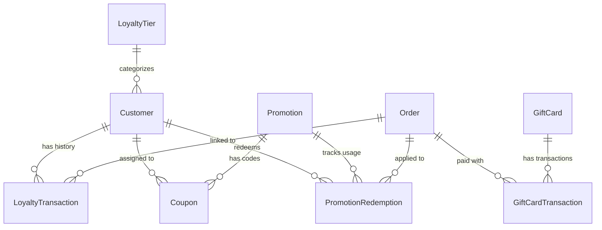

# MUSCHIO — CENTRALIZED PROMOTIONS, LOYALTY & REWARDS ARCHITECTURE

**Date:** November 11, 2026  
**Document Version:** 1.0.0  
**Architect:** Principal Full-Stack & Loyalty Systems Architect  

---

## 1. System Vision & Non-Negotiable Architecture Principle

The Muschio platform operates under a strict, centralized architectural paradigm:

```
  ┌────────────────────────────────────────────────────────┐
  │                 ADMIN PANEL DASHBOARD                  │
  │  (Promotions, Coupons, Vouchers, Gift Cards, Loyalty)  │
  └───────────────────────────┬────────────────────────────┘
                              │
                    RESTful Admin APIs & RBAC
                              │
                              ▼
  ┌────────────────────────────────────────────────────────┐
  │             CENTRALIZED PROMOTION & LOYALTY            │
  │                     ENGINE (API)                       │
  │                                                        │
  │  - Single Point of Truth for Quotes & Validations      │
  │  - Immutable Financial Ledgers (Loyalty & Gift Cards)  │
  │  - Timezone-Consistent UTC Rule Evaluation             │
  │  - Strict Server-Side Cart & Eligibility Breakdown     │
  └───────────────────────────┬────────────────────────────┘
                              │
                    Authoritative Quotes
                              │
                              ▼
  ┌────────────────────────────────────────────────────────┐
  │                 STOREFRONT CLIENTS                     │
  │       (Homepage, Product Detail, Cart, Checkout)       │
  │                                                        │
  │  - Displays Authoritative Backend Quotations           │
  │  - Zero Client-Side Calculations or Assumptions        │
  │  - Displays Clean Fallback If Promotion Is Inactive    │
  └────────────────────────────────────────────────────────┘
```

**Guiding Principles:**
1. **Zero Client Authority:** The client browser never decides a discount amount, points earned, or tier upgrade. All values must be quoted and committed by the backend.
2. **Immutable Transaction Ledgers:** Point awards, redemptions, gift card deductions, and manual adjustments must be recorded as append-only ledger rows with running balances.
3. **Lifecycle-Bound Financial Triggers:** Loyalty points are awarded **only after verified payment capture** (`PAYMENT_CAPTURED`), never upon tentative checkout submission.
4. **Clean Failure States:** When a promotion is disabled, expired, or non-existent, the storefront displays a clean, elegant non-promotional interface rather than a hardcoded fallback or simulated offer.
5. **Full Backward Compatibility:** Existing tables (`Voucher`, `VoucherRedemption`, `Customer`, `Order`) are extended without breaking historical data or schema integrity.

---

## 2. Database Schema Extensions



### 2.1 Promotion & Coupon Entities
* **`Promotion`**: Defines promotional rules, discount types (PERCENTAGE, FIXED_AMOUNT, BUY_X_GET_Y, TIERED_SPEND, FREE_SHIPPING), applicability criteria (products, brands, categories, customer segments, min spend, max discount cap, total and per-customer usage limits).
* **`Coupon`**: Unique alphanumeric codes mapped to a `Promotion`, with optional 1-to-1 customer assignment and expiration dates.
* **`PromotionRedemption`**: Audit record logging the order, customer, coupon code used, and exact monetary benefit granted.

### 2.2 Gift Card Entities
* **`GiftCard`**: Stored-value instrument featuring unique secure codes, initial face value, remaining balance, recipient and sender metadata, and status (ACTIVE, FULLY_REDEEMED, EXPIRED, VOIDED).
* **`GiftCardTransaction`**: Immutable debit and credit ledger tracking ISSUANCE, REDEMPTION, REFUND, and MANUAL_ADJUSTMENT with running balances.

### 2.3 Loyalty & Rewards Entities
* **`LoyaltyProgramConfig`**: Dynamic singleton configuration defining:
  - `isEnabled`: Global kill-switch for loyalty rewards.
  - `pointsPerAedSpent`: Point earning ratio (default 1.0).
  - `pointsRedemptionRate`: Point conversion ratio (default 10 points = 1 AED).
  - `welcomeBonusPoints`: Points granted on account registration (default 100).
  - `minRedemptionPoints`: Minimum threshold to redeem at checkout (default 100).
  - `maxRedemptionAedPerOrder`: Maximum AED credit allowed per single purchase.
* **`LoyaltyTier`**: Configurable tier rules (e.g. Privilege, Gold Sillage, Royal Ambassador) with threshold points/spend, earning multipliers, and localized benefits.
* **`LoyaltyTransaction`**: Immutable ledger recording `points`, `balanceAfter`, `type` (EARN, REDEEM, REFUND, WELCOME_BONUS, MANUAL_ADJUSTMENT, EXPIRE), `reason`, and `adminUserId`.

---

## 3. Promotion Engine Evaluation Pipeline

When evaluating a cart at checkout or quote time:

1. **Step 1: Automatic Promotions Evaluation**
   - Query all active automatic promotions where `isAutomatic = true` and `startsAt <= NOW() <= endsAt`.
   - Filter by customer tier, first purchase eligibility, minimum cart amount, and item inclusions/exclusions.
   - Select the highest-benefit non-stackable promotion or evaluate stackable rules in priority order.

2. **Step 2: Coupon Code Verification**
   - If a coupon code is supplied, fetch the coupon and linked promotion atomically.
   - Validate start/end dates, total usage limit, per-customer usage limit, and assigned customer ID.
   - Validate min order amount and target product/brand filters.
   - Calculate discount with `maxDiscountAmount` cap.

3. **Step 3: Loyalty Credit Redemption Validation**
   - Verify customer authentication.
   - Retrieve current verified point balance from `LoyaltyTransaction` ledger / `Customer`.
   - Check `minRedemptionPoints` and `maxRedemptionAedPerOrder` from `LoyaltyProgramConfig`.
   - Compute maximum allowed AED discount: `min(cartSubtotal - promoDiscount, maxAvailableCredits, maxRedemptionCap)`.

4. **Step 4: Gift Card Balance Validation**
   - Verify gift card is ACTIVE and unexpired.
   - Calculate applied gift card tender up to remaining order payable amount.

5. **Step 5: Authoritative Order Breakdown Response**
   - Subtotal (gross item prices).
   - Automatic discounts (itemized).
   - Coupon discounts (itemized with coupon code).
   - Loyalty credits applied.
   - Gift card tender applied.
   - Net taxable amount & 5% UAE VAT.
   - Delivery fee (including dynamic free shipping rule evaluation).
   - Authoritative final payable amount.
   - Expected loyalty points to be earned upon verified payment capture.

---

## 4. Admin Control Matrix

| Capability | Role Required | Audit Logged | Approval Required |
| :--- | :---: | :---: | :---: |
| View Promotions & Campaigns | VIEWER / MANAGER / SUPER_ADMIN | ❌ | No |
| Create / Edit Promotion Drafts | MANAGER / SUPER_ADMIN | ✅ | No |
| Publish / Pause Promotion | MANAGER / SUPER_ADMIN | ✅ | No |
| Bulk Generate Coupons | MANAGER / SUPER_ADMIN | ✅ | No |
| Issue Stored-Value Voucher / Gift Card | SUPER_ADMIN | ✅ | Configurable (>1,000 AED) |
| Manual Loyalty Point Adjustment | SUPER_ADMIN | ✅ | Mandatory Reason |
| Modify Loyalty Program Ratios | SUPER_ADMIN | ✅ | Yes |
| Export Financial Liability Reports | MANAGER / SUPER_ADMIN | ✅ | No |

